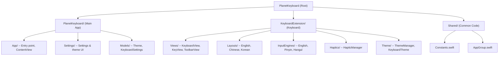

# PlanetKeyboard

> AI context document -- root level. Generated 2026-04-17T10:36:45.

## Project Vision

PlanetKeyboard is a multi-language custom keyboard for iOS supporting English (QWERTY), Chinese (QWERTY Pinyin input), and Korean (Danmoeum / 단모음 layout). The app ships as two targets: a container app for settings and preview, and a Keyboard Extension that iOS loads as a system-wide input method.

## Architecture Overview

- **Language**: Swift
- **UI**: SwiftUI (main app) + UIKit (keyboard extension, required by iOS)
- **Minimum Deployment**: iOS 16+
- **Project Type**: Xcode project with two targets (app + keyboard extension)
- **Data Sharing**: App Groups for communication between the main app and the extension

### Target Map

| Target | Bundle ID Suffix | Role |
|---|---|---|
| PlanetKeyboard (App) | `.PlanetKeyboard` | Settings UI, theme preview, onboarding |
| KeyboardExtension | `.PlanetKeyboard.Keyboard` | System keyboard, input engines, layouts |

## Module Structure



## Module Index

| Module | Path | Language | Role | Entry File |
|---|---|---|---|---|
| Main App | `PlanetKeyboard/` | Swift / SwiftUI | Settings, theme preview, onboarding | `App/PlanetKeyboardApp.swift` |
| Keyboard Extension | `KeyboardExtension/` | Swift / UIKit + SwiftUI | System keyboard, input processing | `KeyboardViewController.swift` |
| Shared | `Shared/` | Swift | Constants, App Group helpers | `Constants.swift` |

## Build and Run

### Prerequisites

- Xcode 15+ (Swift 5.9+)
- iOS 16+ device or simulator
- Apple Developer account (for keyboard extension signing)

### Build Steps

```bash
# Open the project
open PlanetKeyboard.xcodeproj

# Build from Xcode:
# 1. Select the "PlanetKeyboard" scheme for the main app
# 2. Select the "KeyboardExtension" scheme to debug the extension
# 3. Run on a device or simulator (iOS 16+)
```

### Enable the Keyboard on Device

1. Build and run the main app target on a device.
2. Go to Settings > General > Keyboard > Keyboards > Add New Keyboard.
3. Select "PlanetKeyboard".
4. Optionally enable "Allow Full Access" if open-access features are needed.

## Testing Strategy

| Layer | Approach | Location |
|---|---|---|
| Input Engines | Unit tests for Hangul composition, Pinyin conversion, English pass-through | `Tests/InputEngineTests/` |
| Layouts | Snapshot / unit tests for key arrangement correctness | `Tests/LayoutTests/` |
| Theme | Unit tests for theme serialization and App Group persistence | `Tests/ThemeTests/` |
| UI | Manual testing on device (keyboard extensions have limited XCTest support) | -- |

## Coding Conventions

### Naming

- **Files**: PascalCase matching the primary type (`HangulEngine.swift`).
- **Types**: PascalCase (`KeyboardLayout`, `PinyinEngine`).
- **Properties / methods**: camelCase.
- **Protocols**: adjective or noun form (`InputEngineProtocol` or `InputEngineProviding`).

### Patterns

- **Protocol-oriented design** for input engines and layouts so new languages can be added by conforming to a protocol.
- **MVVM-lite** in SwiftUI views; avoid heavy ViewModel layers for the extension (memory budget).
- **Value types** preferred; use classes only where reference semantics or UIKit subclassing require it.
- **No third-party dependencies** in the keyboard extension target, with one deliberate exception:
  librime (+ octagram) as a prebuilt static `Rime.xcframework` for Chinese (see `Tools/README.md`).
- **License**: the app is GPL-3.0 (it ships rime-ice data). Keep `LICENSE` and the in-app notices current.

### Swift Style

- Use `guard` for early returns.
- Prefer `let` over `var`.
- Mark `final` on classes not intended for subclassing.
- Keep files under ~300 lines; split large views into subviews.

## Critical Constraints -- iOS Keyboard Extensions

These constraints are non-negotiable and must be respected in every code change touching the KeyboardExtension target.

1. **Memory limit ~30 MB** -- The extension process is killed if it exceeds this. Avoid caching large dictionaries in memory; use memory-mapped files or on-demand loading.
2. **No network by default** -- Network access requires the `RequestsOpenAccess` entitlement AND user approval ("Allow Full Access"). Do not assume network is available.
3. **Sandboxed process** -- The extension runs in its own process, separate from the main app. Data sharing must go through App Groups (UserDefaults suite or shared container).
4. **Entry point is `UIInputViewController`** -- All keyboard UI is hosted from this controller. SwiftUI views must be wrapped in `UIHostingController` and added as a child view controller.
5. **Orientation changes** -- Must override `viewWillTransition(to:with:)` to handle size class changes and re-layout.
6. **No access to most UIApplication APIs** -- `UIApplication.shared` is unavailable in extensions.
7. **Limited pasteboard access** -- Full pasteboard access requires open access permission.
8. **No background execution** -- The extension is suspended immediately when the keyboard is dismissed.

## AI Usage Guidelines

- When modifying input engines, always run the corresponding unit tests.
- When adding a new language, follow the protocol conformance pattern in `InputEngines/InputEngine.swift` and `Layouts/KeyboardLayout.swift`.
- Never add third-party SPM packages to the KeyboardExtension target (librime is vendored and built by `Tools/rime/`).
- Keep the extension target lean; move non-critical logic to the main app or Shared module.
- Respect the ~30 MB memory ceiling; profile with Instruments before and after changes.

## Changelog

| Date | Action | Details |
|---|---|---|
| 2026-04-17 | Created | Initial project architecture documentation generated from planned structure. |
| 2026-11-24 | Chinese engine | Switched Pinyin to librime + rime-ice + octagram (GPL-3.0 app). |
| 2026-11-25 | Open source | Public repo https://github.com/itsmyCareer/PlanetKeyboard; Vendor/ and Rime binaries are git-ignored (Tools/rime/fetch_sources.sh). Paired 한/EN globe mode, Chinese shift. |
